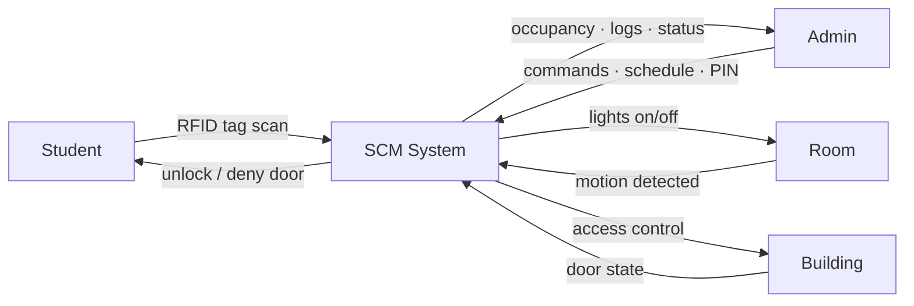
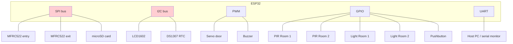
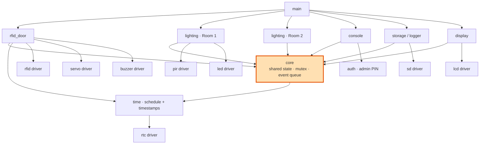
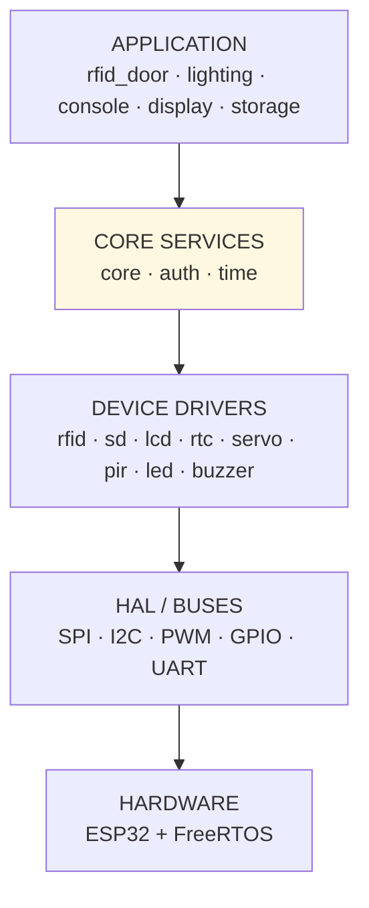

# Architecture

One ESP32. Three terminals as FreeRTOS tasks. All shared state behind one mutex in `core`.

---

## 1. Context diagram

The system is one box. Only actors and the environment sit outside it.



---

## 2. Block diagram — peripherals and buses



**Red = shared bus.** Three devices on SPI, two on I2C. See §5.

---

## 3. Peripherals and protocols

| Peripheral | Wokwi part | Protocol | Owned by | Notes |
|---|---|---|---|---|
| RFID reader (entry) | MFRC522 | **SPI** | rfid_door | own CS pin |
| RFID reader (exit) | MFRC522 | **SPI** | rfid_door | own CS pin |
| microSD card | microSD module | **SPI** | storage | own CS pin; use SDSPI/FATFS driver |
| LCD 16×2 | LCD1602 (I2C backpack) | **I2C** | display | addr 0x27 (sometimes 0x3F) |
| RTC | DS1307 | **I2C** | core/time | addr 0x68; battery-backed |
| PIR sensor ×2 | PIR motion sensor | **GPIO** | lighting | 1 pin, HIGH on motion |
| Light ×2 | LED + resistor | **GPIO** | lighting | |
| Door actuator | Servo | **PWM** | rfid_door | LEDC |
| Buzzer | Buzzer | **GPIO/PWM** | rfid_door | |
| Pushbutton | Pushbutton | **GPIO** | lighting | manual override |
| Serial console | built-in | **UART** | console | |

Use the **new I2C driver** (`driver/i2c_master.h`), not the legacy `driver/i2c.h`.

---

## 4. Organigram — modules and dependencies



**Rule: arrows only point downward.** A module calls the layer below it, never sideways
into a sibling. Everything that must be shared goes through `core`.

---

## 5. Layering diagram



`core` is the widest box in its layer because every application module depends on it.
Swapping a peripheral touches only L2/L1 — nothing above changes.

---

## 6. Synchronisation (requirement 2.7)

Three shared resources, three mechanisms:

| Shared thing | Problem | Mechanism |
|---|---|---|
| **Shared state** (who's inside, occupancy, lights, schedule) | Multiple tasks read/write concurrently → inconsistent records | **Mutex** inside `core`. All state is `static`; only `core` functions touch it. |
| **SPI bus** (2 readers + SD) | Interleaved transactions corrupt data | ESP-IDF SPI driver serialises per-device. `spi_device_acquire_bus()` for multi-step SD writes. |
| **Event log → SD** | Many producers, one slow consumer | **FreeRTOS queue.** Any module calls `core_emit()`; the logger task is the single SD writer, so there is no contention. |

**The `core` discipline:** every public function takes the mutex, copies or updates state,
releases immediately — then any slow work happens on the copy outside the lock. Never hold
the mutex during I/O.

---

## 7. `core.h` — the frozen contract

Every module compiles against this. Do not change it without telling the group.

```c
typedef enum { ROOM_1 = 0, ROOM_2, ROOM_COUNT } room_id_t;
typedef enum { LANE_ENTRY, LANE_EXIT } lane_t;
typedef enum { EV_ENTRY, EV_EXIT, EV_DENIED, EV_LIGHT_ON,
               EV_LIGHT_OFF, EV_CONFIG, EV_ALERT } event_type_t;

typedef struct {
    time_t        ts;
    event_type_t  type;
    uint32_t      uid;     // 0 if not a person event
    room_id_t     room;    // ROOM_COUNT if not a room event
    char          note[24];
} event_t;

esp_err_t core_init(void);

/* access control — called by rfid_door */
bool      core_access_window_open(time_t now);
esp_err_t core_record_entry(uint32_t uid, time_t now);  // ESP_ERR_INVALID_STATE if already inside
esp_err_t core_record_exit (uint32_t uid, time_t now);  // ESP_ERR_INVALID_STATE if not inside
bool      core_uid_known(uint32_t uid, char *name_out, size_t len);

/* occupancy — set by lighting, read by console/display */
void core_set_room_occupied(room_id_t r, bool occupied);
bool core_room_occupied(room_id_t r);
int  core_people_inside(void);
int  core_list_inside(uint32_t *uids, int max);

/* schedule — called by console */
esp_err_t core_schedule_set(uint16_t start_min, uint16_t end_min);  // minutes since midnight
void      core_schedule_get(uint16_t *start_min, uint16_t *end_min);

/* events — any module emits, logger consumes */
void          core_emit(const event_t *e);
QueueHandle_t core_event_queue(void);
```

Other modules expose two or three functions at most:

```c
esp_err_t rfid_door_init(void);
esp_err_t lighting_init(room_id_t r, gpio_num_t pir, gpio_num_t led);
esp_err_t storage_init(void);
int       storage_read_last(int n, event_t *out);
int       storage_count(event_type_t type);
esp_err_t console_init(void);
esp_err_t display_init(void);
```

---

## 8. Module ownership

| Module | Owner | Requirement | Done when |
|---|---|---|---|
| `core` | Joshua | 2.3, 2.7 | Two lanes scanning at once stays consistent |
| `rfid_door` | Jovia | 2.1 | Known tag opens right door; unknown denied; double-entry refused |
| `lighting` | Shirley | 2.2 | Light on with motion, off after N seconds; state reported to core |
| `storage` | Hairat | 2.4 | Events survive reset; `storage_read_last(10)` returns right rows |
| `console` | Prince | 2.5, 2.6 | Every menu item works; schedule change refused without login, persists after reset |
| `display` | Joel | 2.5 | LCD updates within a second of any state change |

---

## 9. Serial console design

Numbered menu — self-documenting and easy to demo.

```
=== CoCIS CONTROL ===
1. Show occupancy
2. Who is inside
3. Show lights
4. View access log
5. Set schedule       [admin]
6. Set time           [admin]
7. Daily report
0. Exit
Select: _
```

Admin items prompt for PIN. Read characters from UART until newline, match, respond.
